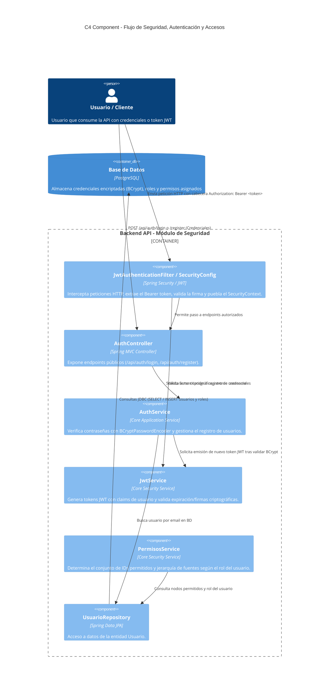
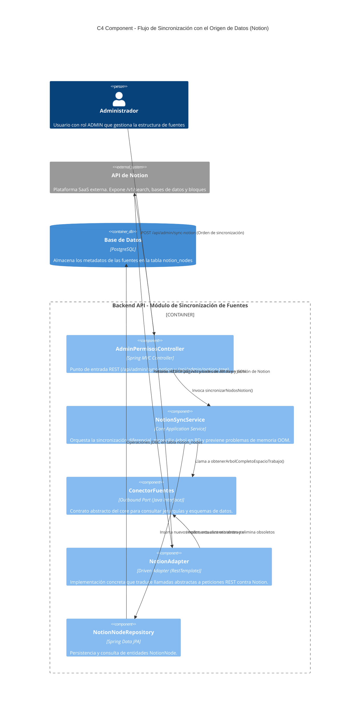
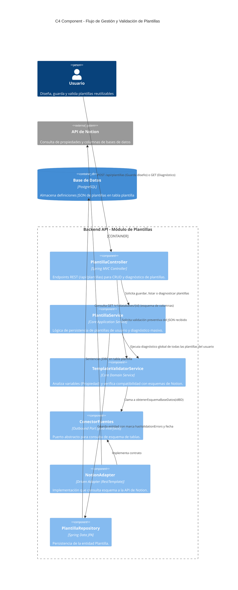
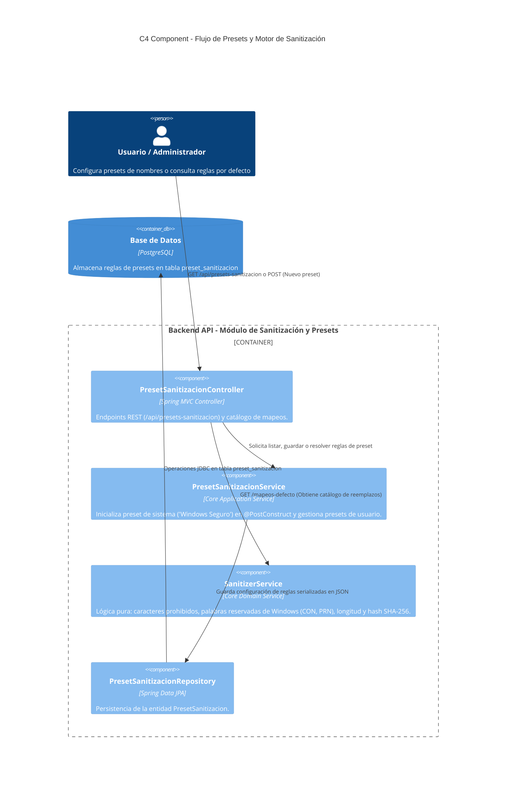

# Diagramas de Componentes por Flujo (Nivel 3 - Modelo C4)

Para facilitar la comprensión técnica y evitar la saturación visual de un único diagrama monolítico, la arquitectura del contenedor **Backend (Spring Boot)** se descompone en sus **flujos de valor y responsabilidades principales**. Todos los flujos respetan estrictamente la **Arquitectura Hexagonal (Puertos y Adaptadores)**.

---

## Índice de Flujos
1. [Flujo 1: Seguridad, Autenticación y Control de Accesos](#flujo-1-seguridad-autenticación-y-control-de-accesos)
2. [Flujo 2: Sincronización con el Origen de Datos (Notion)](#flujo-2-sincronización-con-el-origen-de-datos-notion)
3. [Flujo 3: Generación Asíncrona y Despliegue en Google Drive](#flujo-3-generación-asíncrona-y-despliegue-en-google-drive)
4. [Flujo 4: Gestión y Validación de Plantillas de Estructura](#flujo-4-gestión-y-validación-de-plantillas-de-estructura)
5. [Flujo 5: Presets y Motor de Sanitización de Nombres](#flujo-5-presets-y-motor-de-sanitización-de-nombres)

---

## Flujo 1: Seguridad, Autenticación y Control de Accesos

Este flujo modela la interceptación de peticiones, validación de firmas JWT, autenticación de usuarios y resolución de permisos granulares sobre las fuentes.

---

## Flujo 2: Sincronización con el Origen de Datos (Notion)

Mapea la extracción del árbol de páginas y bases de datos desde la API oficial de Notion hasta su persistencia local como nodos relacionales en base de datos. Se evidencia el desacoplamiento mediante el puerto `ConectorFuentes`.

---

## Flujo 3: Generación Asíncrona y Despliegue en Google Drive

Muestra el procesamiento de las estructuras de carpetas y ficheros. Se destaca la orquestación en segundo plano (`@Async`) para evitar bloqueos y timeouts HTTP, la consulta y extracción de entidades dinámicas y archivos en origen mediante el puerto `ConectorFuentes` (Notion), el despliegue físico a través de los puertos `GestorCarpetas` y `GestorArchivos` (Google Drive), y la trazabilidad de logs.

```mermaid
C4Component
    title C4 Component - Flujo Core de Generación Asíncrona y Despliegue en Drive

    Person(usuario_cliente, "Usuario", "Inicia la construcción física del árbol documental")
    System_Ext(notion_api, "API de Notion", "Origen de datos SaaS. Expone consultas a bases de datos, páginas y URLs de archivos")
    System_Ext(google_drive_api, "API de Google Drive", "Almacenamiento Cloud. Crea directorios y almacena archivos físicos")
    ContainerDb(postgres, "Base de Datos", "PostgreSQL", "Almacena cabeceras de ejecución (generacion) y logs (generacion_log)")

    Container_Boundary(backend_generacion, "Backend API - Módulo de Generación y Despliegue") {

        Component(gen_ctrl, "GeneradorEstructurasController", "Spring MVC Controller", "Endpoint REST (/api/estructuras/generar). Responde HTTP 202 Accepted de inmediato.")
        Component(async_service, "GeneradorEstructurasAsyncService", "Core Application Service (@Async)", "Orquestador asíncrono. Libera el hilo web y ejecuta el proceso pesado en el pool taskExecutor.")
        Component(core_generator, "GeneradorEstructurasService", "Core Domain Service", "Motor nuclear de generación. Recorre recursivamente los nodos, consulta fuentes en origen, evalúa metadatos y emite órdenes de creación.")
        Component(historial_service, "HistorialService", "Core Application Service", "Servicio auxiliar para consulta de ejecuciones previas y métricas de proceso.")

        Component(port_conector, "ConectorFuentes", "Outbound Port (Java Interface)", "Contrato abstracto para ejecutar consultas dinámicas y extraer URLs de archivos en origen.")
        Component(notion_adapter, "NotionAdapter", "Driven Adapter (RestTemplate)", "Implementación concreta que consulta registros y URLs de adjuntos en la API de Notion.")

        Component(port_carpetas, "GestorCarpetas", "Outbound Port (Java Interface)", "Contrato abstracto para resolución de raíz y creación de carpetas.")
        Component(port_archivos, "GestorArchivos", "Outbound Port (Java Interface)", "Contrato abstracto para subida y vinculación física de archivos.")

        Component(drive_adapter, "GoogleDriveAdapter", "Driven Adapter (Google Drive SDK)", "Implementación concreta que se comunica con Google Drive API usando Drive client.")

        Component(gen_repo, "GeneracionRepository", "Spring Data JPA", "Persiste cabeceras de ejecución y estados (IN_PROGRESS, SUCCESS, ERROR).")
        Component(log_repo, "GeneracionLogRepository", "Spring Data JPA", "Persiste trazas de auditoría e incidencias por cada nodo afectado.")

        Rel(usuario_cliente, gen_ctrl, "POST /api/estructuras/generar (JSON de árbol diseñado)")
        Rel(gen_ctrl, gen_repo, "Crea registro inicial con estado IN_PROGRESS")
        Rel(gen_ctrl, async_service, "Delega ejecución en segundo plano y retorna HTTP 202 con el ID generado")

        Rel(async_service, core_generator, "Invoca iniciarGeneracion() en hilo worker desacoplado")

        Rel(core_generator, port_conector, "Consulta entidades dinámicas y extrae URLs de archivos")
        Rel(notion_adapter, port_conector, "Implementa contrato")
        Rel(notion_adapter, notion_api, "Consultas POST /v1/databases/{id}/query y GET /v1/pages/{id}")

        Rel(core_generator, port_carpetas, "Invoca obtenerOCrearCarpetaRaiz() y crearCarpeta(padre, nombre)")
        Rel(core_generator, port_archivos, "Invoca subirArchivo(padreId, documento)")

        Rel(drive_adapter, port_carpetas, "Implementa contrato")
        Rel(drive_adapter, port_archivos, "Implementa contrato")
        Rel(drive_adapter, google_drive_api, "Llamadas SDK Google Drive (driveService.files().create)")

        Rel(async_service, gen_repo, "Actualiza registro final (SUCCESS / ERROR / WARNING y totalArchivos)")
        Rel(async_service, log_repo, "Guarda colección detallada de GeneracionLog")
        Rel(gen_ctrl, historial_service, "Consulta historial y logs para reportar progreso")

        Rel(gen_repo, postgres, "Persistencia JDBC en tabla generacion")
        Rel(log_repo, postgres, "Persistencia JDBC en tabla generacion_log")
    }
```

---

## Flujo 4: Gestión y Validación de Plantillas de Estructura

Muestra el ciclo de vida de las plantillas creadas por los usuarios, incluyendo su almacenamiento y la validación semántica de variables frente a los esquemas de bases de datos remotas.

---

## Flujo 5: Presets y Motor de Sanitización de Nombres

Detalla la gestión de reglas de saneamiento de nombres de carpetas y ficheros (compatibilidad con Windows, eliminación de caracteres prohibidos, longitudes máximas y resolución anti-colisión con hash).

